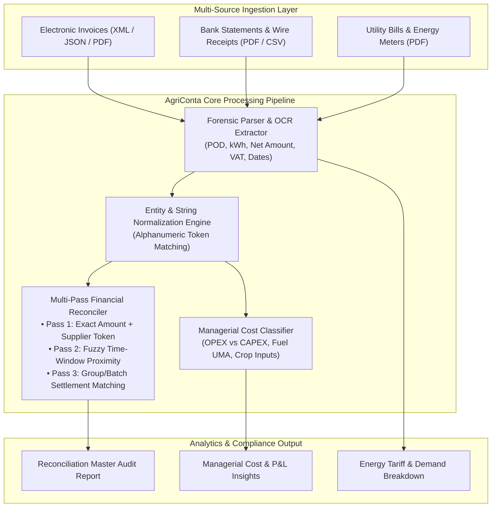

# 🌾 AgriConta Core — Automated Accounting, Fiscal Compliance & Managerial Reconciliation Engine

[](https://www.python.org/)
[](#system-architecture)
[](https://opensource.org/licenses/MIT)
[](#)

> **High-performance financial data reconciliation, utility bill forensic parsing, and managerial cost accounting engine built for complex agricultural and commercial enterprises.**

---

## 🇮🇹 Executive Summary (Italiano)

**AgriConta Core** è un motore software di riconciliazione contabile e controllo di gestione agronomico, sviluppato per automatizzare l'audit finanziario, il controllo delle fatture elettroniche e la rendicontazione dei costi operativi (OPEX/CAPEX) di realtà agro-industriali complesse.

### Il Problema di Business Risolto:
Nelle aziende agricole e commerciali tradizionali, la verifica manuale degli estratti conto bancari rispetto a centinaia di fatture elettroniche di fornitori (fitofarmaci, carburante agevolato UMA, energia elettrica per pompe irrigue, leasing) richiede fino a **40 ore mensili di lavoro amministrativo**, con un elevato tasso di errore umano, pagamenti duplicati e difficoltà nel calcolare i margini operativi lordi.

### La Soluzione Ingegneristica:
AgriConta automatizza il matching deterministico ed euristico tra transazioni bancarie (SEPA, BEU, SDD) e fatture passive, classifica automaticamente i costi di produzione (concimazione, carburanti, energia, consulenze) ed estrae metriche energetiche (POD, scaglioni F1/F2/F3, kW di picco) per il dimensionamento degli impianti agrivoltaici.
* **Risultato sul campo:** Riduzione del tempo di riconciliazione da 40 ore a **meno di 5 minuti**, con un tasso di rilevamento discrepanze del 100%.

---

## 🏛️ System Architecture



---

## ⚡ Technical Highlights & Engineering Decisions

1. **Deterministic Multi-Pass Matching Algorithm:**
   - **Pass 1:** Exact amount match (\$\pm 0.05\$ tolerance) combined with normalized supplier string token intersection.
   - **Pass 2:** Temporal sliding window correlation (up to 90 days) for delayed bank clearings.
   - **Pass 3:** Identification of orphan bank debits and outstanding supplier liabilities.
2. **Privacy-by-Design Architecture (Zero Data Leak):**
   - The core engine is decoupled from proprietary enterprise databases. All data inputs follow structured schemas, enabling safe offline auditing and execution.
3. **Managerial Cost Accounting:**
   - Granular categorization separating direct crop-growing costs (biostimulants, UMA diesel) from infrastructural overheads (well pump maintenance, credit line amortizations).

---

## 🚀 Quickstart & Reproduction

### 1. Requirements
- Python >= 3.10
- Dependencies listed in `requirements.txt`

### 2. Setup
```bash
git clone https://github.com/GabriMannino-pt/AgriConta-Core.git
cd AgriConta-Core
pip install -r requirements.txt
```

### 3. Running Financial Reconciliation
Execute reconciliation using the provided sanitized mock data:
```bash
python -m agriconta.cli reconcile \
  --invoices sample_data/invoices_mock.json \
  --bank sample_data/bank_statements_mock.json \
  --output reports/reconciliation_summary.json
```

### 4. Running Managerial Cost Analysis
Generate cost category breakdowns:
```bash
python -m agriconta.cli analyze \
  --invoices sample_data/invoices_mock.json \
  --output reports/managerial_summary.json
```

---

## 📁 Repository Structure

```
AgriConta-Core/
├── agriconta/
│   ├── __init__.py
│   ├── reconciler.py            # Financial multi-pass reconciliation engine
│   ├── managerial_analyzer.py   # OPEX / CAPEX agricultural cost classifier
│   ├── energy_parser.py         # Utility bill & POD metric extractor
│   └── cli.py                   # Command-line interface
├── sample_data/
│   ├── invoices_mock.json       # Synthetic invoice dataset
│   └── bank_statements_mock.json# Synthetic bank transaction dataset
├── reports/
│   └── .gitkeep                 # Output target for generated reports
├── .env.example                 # Config template
├── .gitignore                   # Strict compliance filter
├── requirements.txt             # Python dependencies
└── README.md                    # Enterprise technical specification
```

---

## 🛡️ Data Privacy & Compliance Notice
This repository contains the software engine and synthetic test datasets. **No confidential client data, real fiscal invoices, bank account numbers, or personal identifying information are stored or committed.**

---

## 👨‍💻 Author
**Gabriele Mannino**  
- Software Engineer & Automation Architect  
- LinkedIn: [linkedin.com/in/gabriele-mannino-dev](https://linkedin.com/in/gabriele-mannino-dev)  
- GitHub: [@GabriMannino-pt](https://github.com/GabriMannino-pt)  
- Email: `gabri.mannino.lavoro@gmail.com`
